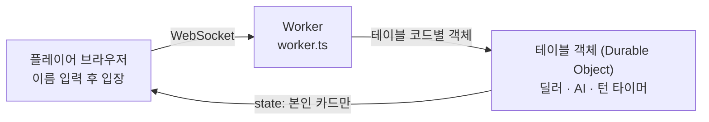

# 홀덤 멀티플레이 배포 구성안

작성일: 2026-11-15

링크만 있으면 누구나 로그인 없이 참가하는 멀티플레이 홀덤을 직접 배포하기 위한 구성입니다. 서버는 Cloudflare Workers와 Durable Objects를 사용하고, 서버와 클라이언트 코드는 한 저장소에 둡니다.



## 1. 권장 구성: Cloudflare Workers + Durable Objects

Durable Object는 이름 하나에 인스턴스 하나만 존재하는 서버 객체입니다. 테이블 하나를 객체 하나로 두면 다음 조건이 자연스럽게 맞습니다.

- **진행 문제가 사라집니다.** 서버가 딜러를 맡으니 누구 브라우저가 진행을 맡는지, 그 사람이 나가면 핸드가 무효되는지를 신경 쓸 필요가 없습니다.
- **동시성 처리가 필요 없습니다.** 객체 하나가 단일 스레드로 돌기 때문에 행동이 동시에 들어와도 순서대로 처리됩니다.
- **카드 보안이 확실해집니다.** 각 플레이어에게 자기 카드만 들어간 화면 상태를 따로 보내므로 암호화가 필요 없고, 개발자 도구로도 남의 카드를 볼 수 없습니다.
- **요금 폭탄이 없습니다.** 무료 플랜은 한도를 넘으면 요금이 청구되지 않고 요청이 실패합니다.

SQLite 저장소를 쓰는 Durable Objects는 무료 플랜에서도 사용할 수 있습니다.

| 항목 | 무료 한도 |
| --- | --- |
| 요청 | 하루 100,000건 |
| 실행 시간 | 하루 13,000 GB-초 |
| SQLite 행 읽기 / 쓰기 | 하루 500만 / 10만 행 |
| SQLite 저장 용량 | 총 5 GB |

들어오는 WebSocket 메시지는 20개가 요청 1건으로 계산됩니다. 객체 하나가 128 MB 기준으로 계산되므로, 테이블 하나가 하루 약 28시간 동안 활성 상태여도 실행 시간 한도 안입니다(13,000 ÷ 0.125 GB ≈ 104,000초).

## 2. 저장소 구조 (한 저장소, 패키지 하나)

서버와 클라이언트를 한 저장소에 둡니다. pnpm workspaces나 Turborepo 같은 모노레포 도구는 이 규모에서 필요 없고, 패키지 하나 안에서 폴더만 나눕니다.

```
holdem/
├─ package.json            # 패키지 하나
├─ wrangler.jsonc          # 정적 파일 경로, Durable Object 바인딩
├─ vite.config.ts          # Cloudflare Vite 플러그인
└─ src/
   ├─ shared/              # 순수 함수와 타입만
   │  ├─ engine.ts         # evaluate / best5 / equity
   │  └─ protocol.ts       # join · act · state 메시지 타입, 프로토콜 버전
   ├─ server/
   │  ├─ worker.ts         # /t/:code/ws → 테이블 객체
   │  ├─ table.ts          # Durable Object (덱, 진행, 타이머)
   │  └─ bot.ts            # AI는 서버에만
   └─ client/
      ├─ index.html
      └─ main.ts           # 지금 UI 코드
```

**한 저장소가 맞는 이유**

- **함께 배포됩니다.** Worker 하나가 정적 파일(클라이언트)과 WebSocket(서버)을 같이 서비스하므로, 배포 한 번에 둘이 같은 버전으로 올라갑니다.
- **공유 코드가 있습니다.** 족보 판정 엔진은 서버의 승패 판정과 클라이언트의 내 패 이름·승률 표시에 모두 쓰입니다. 메시지 타입을 한 파일에 두면, 한쪽만 고쳤을 때 양쪽에서 바로 컴파일 오류가 납니다.

**구성할 때 지킬 점**

- **`shared`에는 순수 함수와 타입만 둡니다.** 덱이나 테이블 상태를 다루는 코드는 `server`에만 둬야 클라이언트 번들에 섞여 들어가지 않습니다.
- **WebSocket 경로만 Worker 코드를 먼저 거치게 합니다.** 정적 파일은 기본적으로 Worker 코드를 거치지 않고 바로 나갑니다. `run_worker_first`에 `["/t/*"]` 같은 패턴을 넣어 WebSocket 경로만 Worker 코드로 보냅니다.
- **`join` 메시지에 프로토콜 버전을 넣습니다.** 배포 전에 열어 둔 탭은 옛 클라이언트로 남아 있으니, 버전이 다르면 새로고침하라고 안내합니다.
- **Cloudflare Vite 플러그인을 씁니다.** 개발 중에도 Worker 코드를 실제 배포 환경과 같은 런타임(workerd)에서 실행하고, 클라이언트와 Worker를 함께 빌드합니다. 공식 문서에 Durable Objects 지원이 명시되어 있지 않으니, 처음 구성할 때 확인합니다.
- **네이티브 iOS 클라이언트를 추가하게 되면** `apps/web`과 `apps/ios`로 나눕니다. Swift는 TypeScript 코드를 쓸 수 없으니, 그때 `protocol.ts`를 JSON Schema 같은 언어 중립적인 정의로 옮깁니다.

## 3. 동작 방식

로그인 없이 링크만으로 들어오고, 빈자리는 항상 AI가 채웁니다.

- **테이블 주소:** `https://<이름>.workers.dev/t/k7m2`처럼 테이블마다 코드를 붙입니다. 코드가 같으면 같은 테이블 객체로 연결됩니다.
- **입장:** 이름을 입력하면 브라우저가 무작위 토큰을 만들어 저장합니다. 새로고침하거나 다시 들어와도 같은 자리로 돌아옵니다.
- **AI 자리:** 6자리 중 빈자리는 AI가 채웁니다. 사람이 들어오면 다음 핸드가 시작될 때 AI 한 자리를 넘겨받고, 사람이 나가면 AI가 다시 채웁니다. 핸드 도중에는 자리를 바꾸지 않습니다.

통신은 WebSocket 위의 JSON 메시지입니다.

| 방향 | 메시지 | 내용 |
| --- | --- | --- |
| 브라우저 → 서버 | `join` | 이름, 토큰, 프로토콜 버전 |
| 브라우저 → 서버 | `act` | 턴 번호(seq), 행동 종류, 레이즈 금액 |
| 브라우저 → 서버 | `away` / `back` / `rebuy` / `leave` | 자리 비움, 복귀, 다시 바이인, 나가기 |
| 서버 → 브라우저 | `state` | 받는 사람에 맞춰 걸러진 화면 상태 (본인 카드만 포함) |

## 4. 구현할 때 주의할 점

1. **WebSocket 휴면 API를 씁니다.** `ctx.acceptWebSocket()`과 `webSocketMessage()` 핸들러를 사용합니다. 일반 `accept()`를 쓰면 접속이 유지되는 동안 계속 실행 시간이 과금됩니다.
2. **상태는 매번 저장소에 기록합니다.** 휴면하거나 재시작하면 메모리가 비워지므로, 행동을 처리할 때마다 `ctx.storage`에 상태를 저장합니다.
3. **턴 타이머는 `setAlarm()`으로 겁니다.** `setTimeout`은 휴면을 견디지 못합니다. AI가 생각하는 0.5~1초 지연 정도는 `setTimeout`으로 충분합니다.
4. **누구나 들어오는 링크이므로 최소한의 방어를 넣습니다.**
    - 이름 길이를 제한합니다.
    - 접속당 메시지 속도를 제한합니다.
    - 서버가 모든 행동을 다시 검증합니다(차례 확인, 최소 레이즈 등).

## 5. 다른 선택지

| 구성 | 장점 | 단점 |
| --- | --- | --- |
| Node + ws를 Render 무료 플랜에 배포 | 가장 익숙한 구조 | 15분 동안 트래픽이 없으면 꺼지고, 다시 켜지는 데 약 1분이 걸립니다. 재시작하면 메모리에 있던 게임 상태가 사라집니다 |
| Fly.io | 항상 켜진 VM | 2024년 10월부터 신규 가입자에게 무료 플랜이 없습니다 |
| Vapor (Swift) | Swift로 통일 | 게임 엔진을 Swift로 다시 옮겨야 하고, 화면은 결국 JavaScript입니다 |

Render는 2026년 2월 24일부터 기존 연결로 들어오는 WebSocket 메시지도 트래픽으로 인정합니다. 게임이 진행되는 동안에는 꺼지지 않지만, 아무도 없던 시간 뒤에 처음 들어오는 사람은 1분 정도 기다려야 합니다.

## 6. 다음 단계

- [ ] 위 구조로 프로젝트 작성
- [ ] 로컬에서 여러 명 접속 검증 (Durable Objects가 Vite 개발 서버에서 도는지 함께 확인)
- [ ] Cloudflare 계정에 로그인하고 배포
- [ ] 필요하면 GitHub 저장소로 관리

## 출처

- [Cloudflare Durable Objects 요금](https://developers.cloudflare.com/durable-objects/platform/pricing)
- [Cloudflare Workers 정적 파일 (Static Assets)](https://developers.cloudflare.com/workers/static-assets/)
- [Cloudflare Vite 플러그인](https://developers.cloudflare.com/workers/vite-plugin/)
- [Render 무료 플랜 제한](https://render.com/docs/free)
- [Render 변경 기록: 무료 서비스가 WebSocket 메시지로도 유지됨 (2026-02-24)](https://render.com/changelog/free-web-services-now-remain-active-while-receiving-websocket-messages)
- [Fly.io 종료된 플랜 안내](https://docs.fly.io/about/discontinued-plans)
